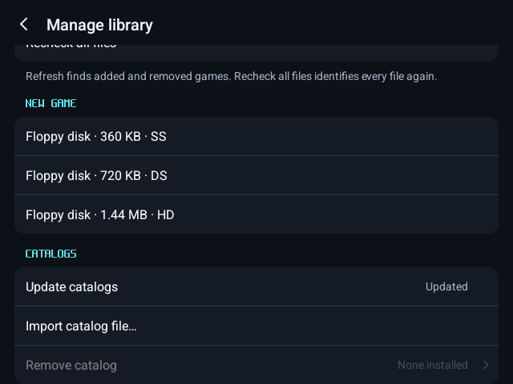
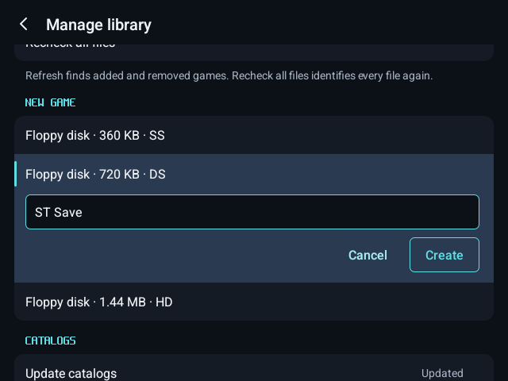
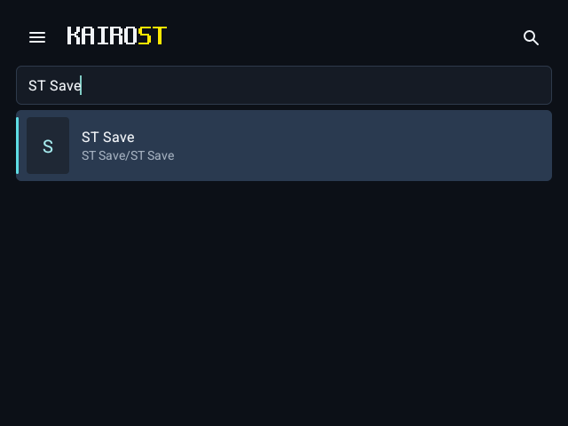
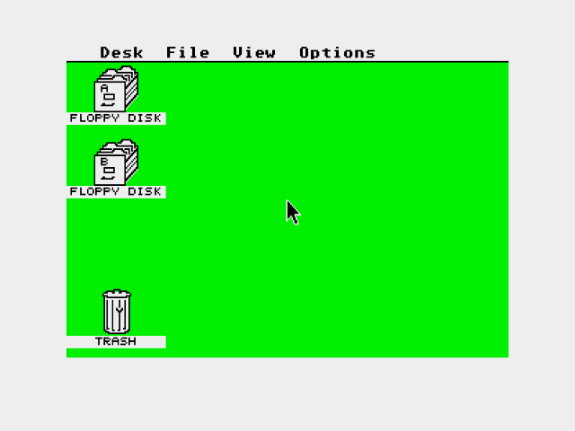
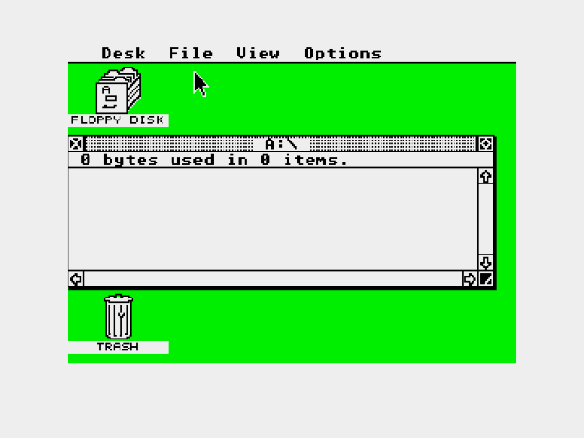
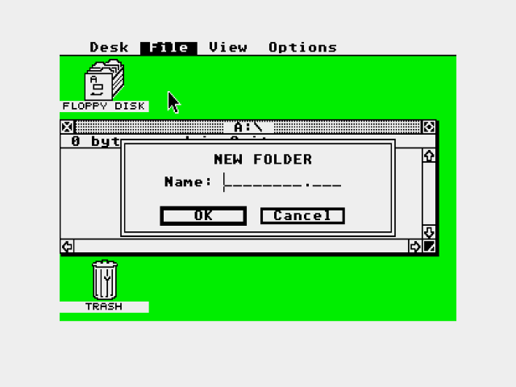
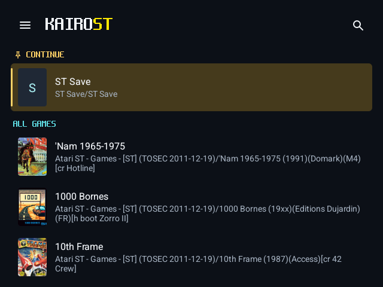
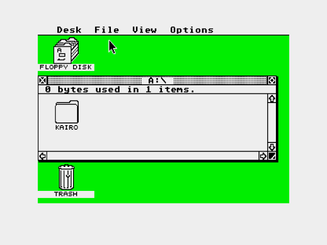

# Create a game

Make a new game on a blank floppy: a save disk a game asks for, or a disk to copy files to. KairoST makes the floppy formatted and empty, as Hatari's own "create blank image" does. Your game disks can stay wherever they are (for example in Download): the Disks page takes them from anywhere on the device.

## 1. Create the blank floppy

Open the library menu › **Manage library**. Under **New game**, choose a 360 KB single-sided, 720 KB double-sided or 1.44 MB high-density floppy.

Name the game and press **Create**. KairoST makes a folder of that name in your games folder with the blank floppy in it.

## 2. Start it

Press **Play**: the desktop starts with the new floppy in drive A. A game's disk goes in drive B through the menu › **Disks** › **Choose file…**, from wherever it is.

## 3. It is ready to use

The floppy is already formatted: select drive A and choose **File › Open** to see it empty.

## 4. Write to it

Copy files to it, or let a game write its saves to it. Here **File › New Folder…**:

## 5. It keeps what is written

The floppy is in your library under the name you gave it.

After closing and reopening KairoST, drive A still holds what was written.

